# Práctica 2 · Conociendo tu IMC

App en Flutter/Dart de una sola pantalla que captura nombre, peso (kg) y estatura (cm), calcula el Índice de Masa Corporal y dice el estatus de la persona.

- **Alumno:** Oscar Manuel Ayala Ortiz
- **Grupo:** GTID244 · **Núm. de control:** 1225100784
- **Materia:** Desarrollo de Aplicaciones Móviles (UTNG)

## Qué hace

- Fórmula: `IMC = peso ÷ (estatura en metros)²`, con la estatura capturada en centímetros y el resultado redondeado a un decimal.
- El redondeo se hace antes de clasificar:
  - menor a 18.5: bajo peso
  - 18.5 a 24.9: peso normal
  - 25.0 a 29.9: sobrepeso
  - 30.0 o más: obesidad
- El resultado sale en un diálogo y en una etiqueta con borde de color según la categoría.
- Si falta un dato o no es número, muestra el diálogo "Datos incompletos".
- **Limpiar datos** vacía campos y etiqueta. **Salir** pide confirmación y cierra la app (en Android).

## Cómo ejecutarla

```
flutter pub get
flutter run -d chrome
```

## Evidencia de funcionamiento

| Estado inicial | Diálogo de resultado | Etiqueta con el resultado |
|---|---|---|
| 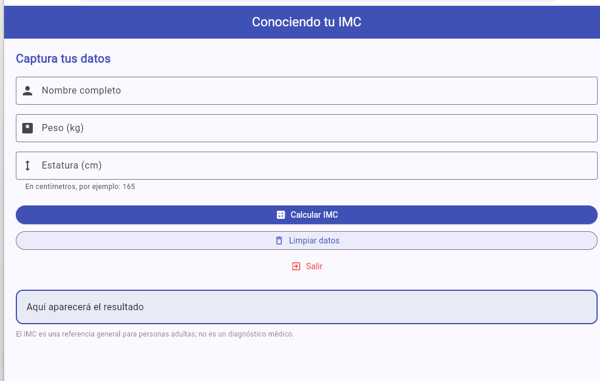 | 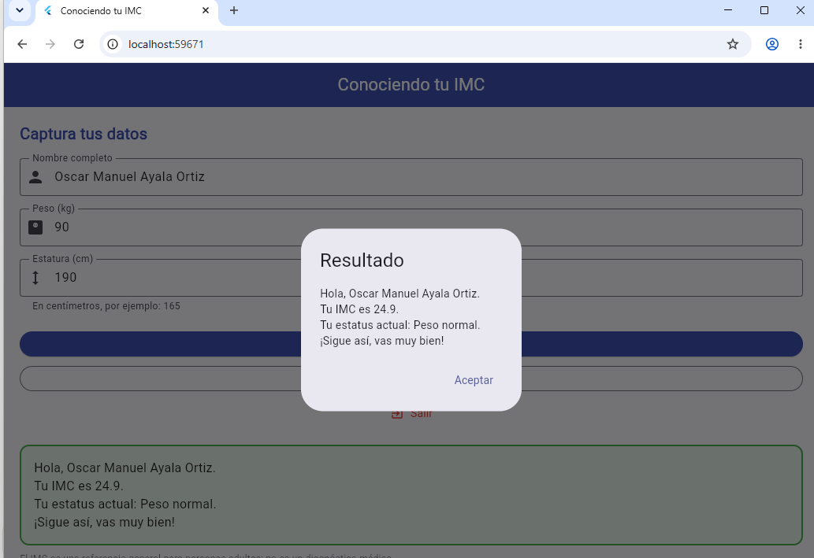 | 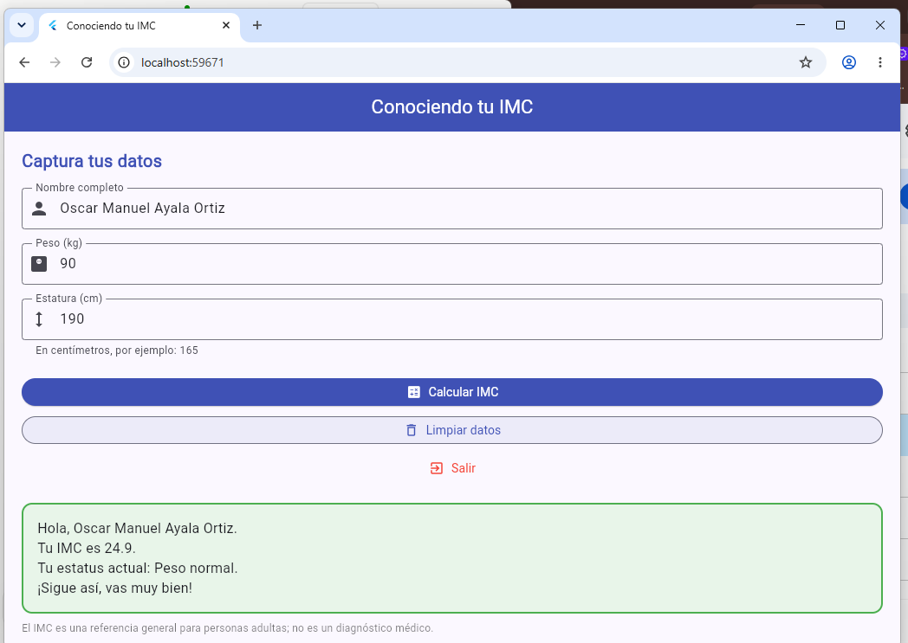 |

## Casos de prueba

| # | Datos | IMC esperado | Categoría | Captura |
|---|---|---|---|---|
| 1 | Ana · 45 kg · 160 cm | 17.6 | Bajo peso | 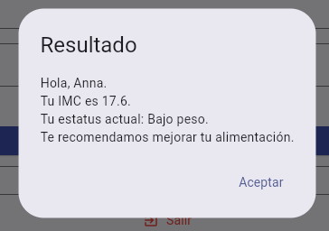 |
| 2 | Luis · 70 kg · 175 cm | 22.9 | Peso normal | 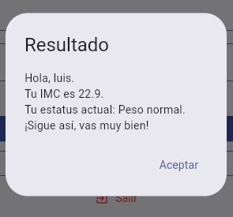 |
| 3 | Carla · 75 kg · 165 cm | 27.5 | Sobrepeso | 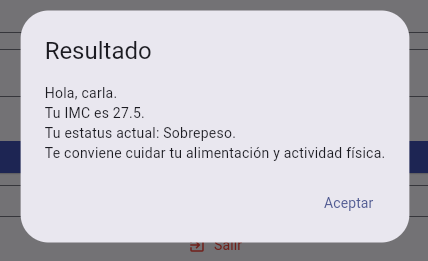 |
| 4 | Pedro · 100 kg · 170 cm | 34.6 | Obesidad | 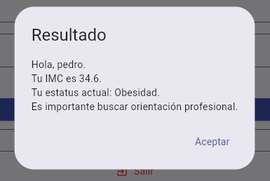 |
| 5 | Límite: 60 kg · 180 cm | 18.5 | Peso normal | 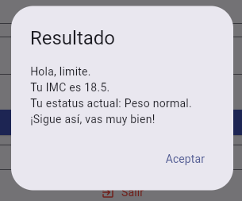 |
| 6 | Límite: 73 kg · 170 cm | 25.3 | Sobrepeso | 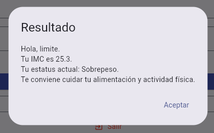 |
| 7 | Límite: 87 kg · 170 cm | 30.1 | Obesidad | 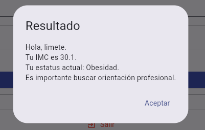 |
| 8 | Campos vacíos | — | Diálogo "Datos incompletos" | 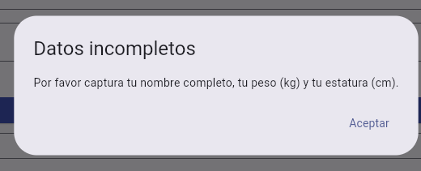 |
| 9 | Limpiar datos | — | Campos y etiqueta vacíos | 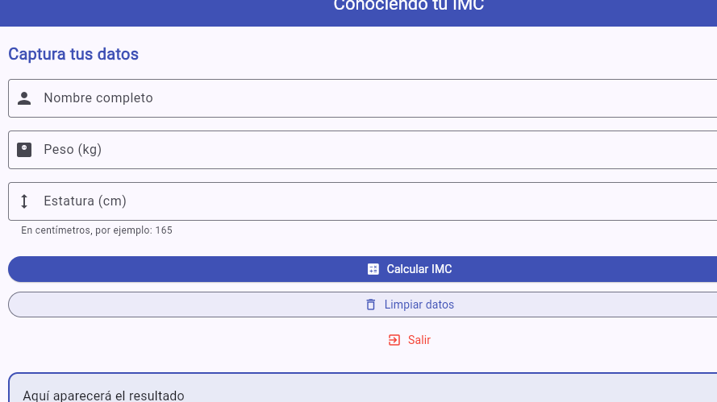 |
| 10 | Salir | — | Confirmación de salida | 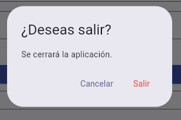 |

El IMC es una referencia general para personas adultas; no es un diagnóstico médico.
